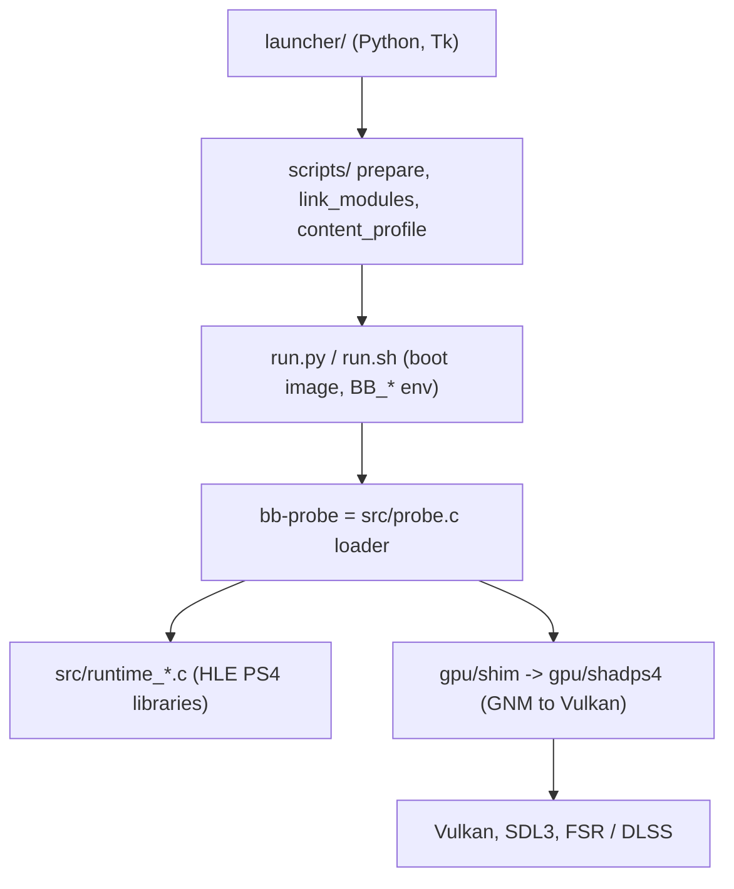

# Code map: uncharted_pc (fork)

- Repo: iannitram/uncharted_pc, a fork of Supermedo/uncharted_pc (C, C++20, Python; GPL-2.0-or-later parts from shadPS4).
- Kind: a native port (not an emulator) that runs the decrypted PS4 build of Uncharted: The Nathan Drake Collection as an x86-64 image, with the PS4 system libraries reimplemented in C and GNM graphics translated to Vulkan through a vendored shadPS4 renderer. Ships a Python launcher.
- Integration branch: `linux` (not `main`). Described commit: `0170fb113` (2026-10-26). `main` is the release branch of the sync workflow described under CI.
- Upstream: `Supermedo/uncharted_pc` (`upstream/main`). A second source, `spacepepperoni/uncharted_Linux`, is merged separately. Nothing is posted to either.
- No game files, keys or RE output are in the repo; the user supplies a decrypted dump.
- Naming oddity: many file and variable names use `bbport` / `BB_*` / `bb-probe` because the code started as a Bloodborne port. `patches/Bloodborne.xml` is still Bloodborne's patch database and does not apply to Uncharted.

## Layout

| Path | What it owns |
|---|---|
| `src/` | The host runtime in C (about 10.5k lines). `probe.c` is the loader (ELF mapping, import resolution by NID, guest hooks, fault handling, MOVBE emulation); `runtime_*.c` is one file per PS4 library (memory, thread, fiber, mutex/rwlock/sema, file VFS, pad over SDL3, audio, AJM decode, display, savedata, trophy, rtc, services, content); `cpu_patch.c` and `red_zone.c` are code patching; `compat_win.c` has MinGW POSIX shims; `vulkan_smoke.c`. |
| `gpu/` | The renderer. `CMakeLists.txt` builds the GPU library and `bb-probe`. `shadps4/` is shadPS4 pinned to one commit (`VENDOR.txt`), with local edits marked `bbport:`; `shim/` is the port's own C++ layer (ImGui settings menu, window, async copy threads, overlay); `bbgpu.h` is the C ABI; `bbnet/` network glue for private co-op; `dlss_bridge/` optional NVIDIA DLSS bridge; `patches/fsr-vulkan/` patches applied to the FSR submodule; `tools/`; `third_party/` submodules. |
| `launcher/` | Python/Tk launcher (`uncharted_launcher.py`, `bbport_*.py` helpers for Steam, Vulkan, i18n, assets), desktop entry, icons, covers, fonts. |
| `scripts/` | Python prep tools run by the launcher or `run.py`: `prepare.py`, `link_modules.py`, `link_libc.py`, `content_profile.py`, `patches.py`, `pkg.py`, `mods.py`, `cheats.py`, `trophies.py`, `render_720p.py`. |
| `run.py`, `run.sh` | Builds the boot image and sets `BB_*` environment, then starts `bb-probe`. `BB_PREBUILT=1` is the packaged mode. |
| `build.sh` | Native build (Linux gcc/cc, or MSYS2 CLANG64 on Windows); `build.sh --test` compiles and runs the C and C++ tests. |
| `msys2-env.sh`, `shell.nix`, `packaging/default.nix` | Windows toolchain env; Nix shell. |
| `packaging/` | `linux/` (AppImage, `package.sh`, `AppRun`, desktop file), `windows/` (PyInstaller packaging, resources, DLSS/XeSS fetch scripts, READMEs), `appimage.sh`, `bbport-entry.c`. |
| `patches/Bloodborne.xml` | Community patch database (Bloodborne only). |
| `third_party/` | LibAtrac9, Vulkan-Headers submodules. |
| `tools/` | Dev helpers: frame A/B (`ab.sh`), `soak.sh`, stack and freeze tools, FSR4 capture and optimize scripts (`fsr4cap/`), name importers, `gpu_capabilities.c`. |
| `tests/` | C/C++ unit tests (`test_runtime.c`, `test_pad.c`, `test_sema.c`, `test_cpu_patch.c`, `test_eop_matcher.c`, shader and motion tests) and about 28 Python `unittest` files (launcher, patches, pkg, mods, trophies, i18n, display). |
| `docs/` | `ARCHITECTURE.md`, `LINUX_BUILD.md`, `BUILDING_LINUX.md`, `ROADMAP.md`, `upscaler.md`, `PKG.md`, `MODS.md`, `resolution.md`, `parallel_gpu.md`, `DEVELOPMENT_LOG.md`, `maps/overview.md`, `review-2026-10-24/` (code review and delivery roadmap), Russian translations in `ru/`, `history/`. |
| `Research/` | Background research notes (architecture, upscaling, licensing, similar projects). |
| `.github/workflows/` | `build.yml`, `sync-upstream.yml`. |

## How it fits together



- The decrypted game image is mapped and executed directly; imports are bound by scoped NID to `runtime_resolve()`, and an unresolved import stops the process rather than stubbing a fake success.
- Graphics: GNM command streams are translated by the vendored shadPS4 `video_core` and `shader_recompiler`; the port adds TAA, camera-motion, frame-generation inputs and FSR passes as host shaders (`gpu/shadps4/video_core/host_shaders/`, see `docs/upscaler.md`).
- Runtime knobs are `BB_*` environment variables or `bbport.ini` (frame stats, frame capture, toggles for A/B).
- Detail: `docs/ARCHITECTURE.md`.

## Where our work is

`git log upstream/main..HEAD` shows 241 commits and `git diff upstream/main...HEAD` is 166 files (+17,308 / -2,203); upstream is not ahead of `linux` at this snapshot. Most of the 241 commits come from other contributors and from the spacepepperoni fork's history (about 56 by its maintainer, 22 by one Deck contributor, 10 by Supermedo, the rest scattered); about 62 are ours. Our commits concentrate on:

| Area | Files |
|---|---|
| Docs: `docs/review-2026-10-24/` code review and cross-platform roadmap, `ROADMAP.md`, `LINUX_BUILD.md`, `docs/history/`, `docs/ru/`, `Research/` | most of our changed lines |
| Patch handling: `scripts/patches.py`, `tests/test_patches.py` (per-executable third-party patches, `APP_VER` decides the external version, own-executable-only patches) | few files |
| Renderer fixes under `gpu/shadps4/` (nested indirect-buffer frame leak, `WAIT_ON_CE_COUNTER` guard, compute ring offset reset) and FSR 3.1 defaults/protected-memory handling | about 300 changed lines |
| `src/runtime_trophy.c`, `src/runtime_thread.c` (GCC 15 `-Werror` fixes), MXCSR test, `tests/test_eop_matcher.c`, `render_720p` tests | few files |

Two stray commits ("index on ..." and "untracked files on ...") are stash artifacts from an experiment branch; leave them.

## Build and test

Linux (per `docs/LINUX_BUILD.md` and `build.yml`; GCC 14+ is required for C++23, Debian trixie is what CI uses):

```sh
git submodule update --init --recursive
bash build.sh              # builds out/bb-probe and the GPU library
bash build.sh --test       # C and C++ tests
bash run.sh                # starts the game (BB_PREBUILT=1 for packaged builds)
bash packaging/linux/package.sh   # AppImage and tarball
```

Python tests are `unittest` files in `tests/`, importing the scripts through `tests/paths.py`; no runner command is stated in the repo, so use `python3 -m unittest discover -s tests`.

Needs Vulkan, SDL3, fmt, Boost, tsl-robin-map, VMA, xxhash, Zydis, FFmpeg libraries, protobuf, nlohmann-json, OpenSSL, zlib, miniupnpc and glslang (the exact list is in `build.yml`).

CI: `build.yml` (job `build` in a `debian:trixie` container on ubuntu-latest: install dependencies, `build.sh`, package, upload the AppImage and tarball, and create a release on `main`); it skips doc-only changes. `sync-upstream.yml` merges `Supermedo/uncharted_pc` into an `upstream-merge` branch every six hours, builds it, and only a passing merge reaches `main`. CI does not run `build.sh --test` or the Python tests.

## Mac / PC / Linux

- Linux x86-64 is the target of this branch and the only platform CI builds. Hardware testing (Steam Deck, handhelds) is manual. R04: a Linux machine must run the game before a sync is merged; CI proves only that it builds.
- Windows: built with MSYS2 CLANG64 (`build.sh` branch for MINGW, `packaging/windows/`, `launcher/bbport_launcher_win.py`); the code carries Windows-specific paths in `src/compat_win.c`, `runtime_memory.c` and `runtime_thread.c`. No Windows CI job here.
- macOS: out of scope (the roadmap puts it outside the launcher phase; Linux and Windows only).
- Needs a Vulkan GPU; DLSS needs NVIDIA.

## Open-source pieces

shadPS4 (vendored GNM/Vulkan renderer and shader recompiler, GPL-2.0-or-later, pinned commit in `gpu/VENDOR.txt`, plus shadNet/np parts from shadp2p), FireBurn/FSR-Vulkan (FSR 3.1, submodule, patched), Dear ImGui (in-game menu), xbyak, magic_enum, miniz (submodules), LibAtrac9 (ATRAC9 audio), Vulkan-Headers, Vulkan Memory Allocator, SDL3 (window and input), FFmpeg (MP3 and video), Zydis (x86 decoding for patching), Protobuf, nlohmann-json, OpenSSL, miniupnpc (co-op networking), Tracy hooks in the shim, and optional NVIDIA DLSS/NGX and XeSS (fetched, not committed).
