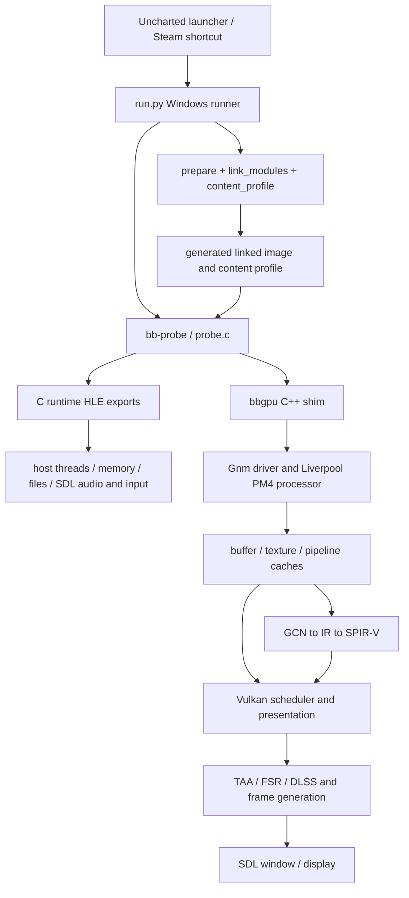

# Code map

Baseline: `68c8cf9a6563d653ed17ce72d758aaa5f33a7a76`. 902 tracked paths at review time; submodule contents are separate dependencies. This map describes source responsibilities, not execution coverage.

| Area | Entry points / implementation | Responsibility and review boundary |
|---|---|---|
| User flow | `launcher/uncharted_launcher.py`, `uncharted_widgets.py`, `bbport_steam.py` | Tk UI, settings, game selection, updates, child process and Steam integration. Older `bbport_launcher*` modules retain Bloodborne behavior. |
| Launch orchestration | `run.py`, `run.sh` | Python runner selects collection executable and handles LoadExec; shell runner is inherited Linux/Bloodborne path requiring reconciliation. |
| Binary preparation | `scripts/prepare.py`, `link_modules.py`, `link_libc.py`, `content_profile.py` | Validate SELF/SFO, build linked host-runnable image, resolve imported module exports, create offline content profile. Generated outputs live in out/. |
| Loader | `src/probe.c`, `src/runtime.h`, `runtime.c`, `import_names.inc` | Map guest image, import resolution, guest entry, faults/watchdogs and game-specific patches; ABI bridge is a correctness boundary. |
| Memory / concurrency | `runtime_memory.c`, `runtime_thread.c`, `runtime_fiber.c`, `runtime_mutex.c`, `runtime_rwlock.c`, `runtime_sema.c`, `runtime_kernel.c` | Backing allocation and VMA protection, guest TLS/thread lifecycle, synchronization and kernel emulation. Windows host compatibility in `compat_win.c/.h`. |
| Storage / services | `runtime_file.c`, `runtime_savedata.c`, `runtime_content.c`, `runtime_services.c` | Guest mounts/descriptors, save persistence, title/content APIs, system dialogs and LoadExec. |
| Audio / input / clock | `runtime_audio.c`, `runtime_ajm.c`, `runtime_pad.c`, `runtime_time.c`, `runtime_rtc.c` | SDL output/input, AJM batches/ATRAC9, guest timing. `third_party/LibAtrac9` supplies decoding. |
| GPU adaptation | `gpu/shim/bbgpu.cpp`, `bbport_settings*`, `bbport_overlay*`, `bbport_copy*`, `window.cpp`, shim `core/` | Adapt shadPS4 APIs to native HLE; service thread, settings, overlay and parallel work. |
| Guest GPU commands | `gpu/shadps4/core/libraries/gnmdriver/`, `video_core/amdgpu/liverpool.cpp` | Gnm export handling, compute rings, PM4 packet decoding and coroutine synchronization. |
| GPU resources | `video_core/buffer_cache/`, `texture_cache/` | Guest/host ownership, protected-memory tracking, uploads, refresh/overlap/expansion and resource lifetime. |
| Rendering / optimization | `video_core/renderer_vulkan/` | Device/features, scheduler, draw recording, barriers, readbacks, scene resolution, temporal history, UI composition, upscaling and frame generation. |
| Shader compilation | `gpu/shadps4/shader_recompiler/`, `gpu/third_party/sirit/` | Decode GCN, translate/optimize IR, emit SPIR-V; shader changes must version cache keys. |
| Video decoding | `gpu/shadps4/core/libraries/videodec/` | FFmpeg decode and guest video frame output; independent of AJM audio decoder support. |
| Vendor bridges | `gpu/dlss_bridge/`, `gpu/third_party/fsr-vulkan/`, `gpu/patches/fsr-vulkan/` | DLSS Windows bridge and patched FSR Vulkan integration; inspect binary/license/platform availability before packaging. |
| Build / distribution | `build.sh`, `gpu/CMakeLists.txt`, `packaging/windows/`, `packaging/appimage.sh`, `shell.nix` | Windows static/native loader and Linux shared GPU library; packaging, dependencies, assets and notices. |
| Validation / diagnostics | `tests/`, `tools/gpu_capabilities.c`, `tools/soak.sh`, `tools/watch_freeze.py`, capture tools | Native and Python tests, feature probing, soaks and performance diagnostics. Full runtime tests require compiled binaries. |

Changes to ABI/TLS need thread and loader tests; memory ownership changes need CPU/GPU synchronization tests; renderer optimizations need image correctness plus fence/lifetime validation. Platform changes should share orchestration while keeping host memory, TLS, exceptions and process semantics explicit.
